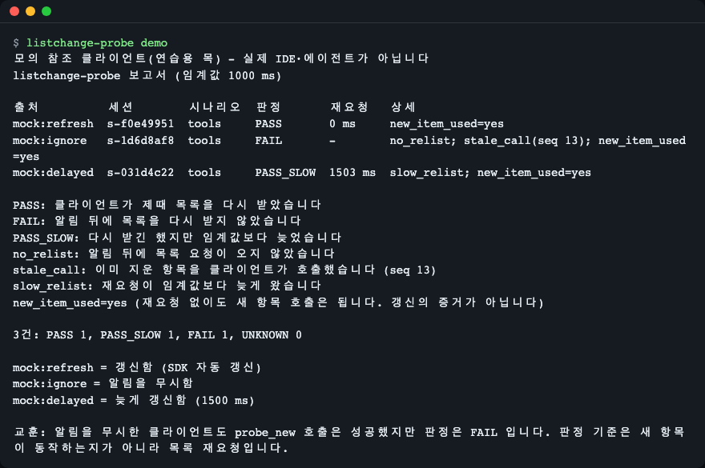
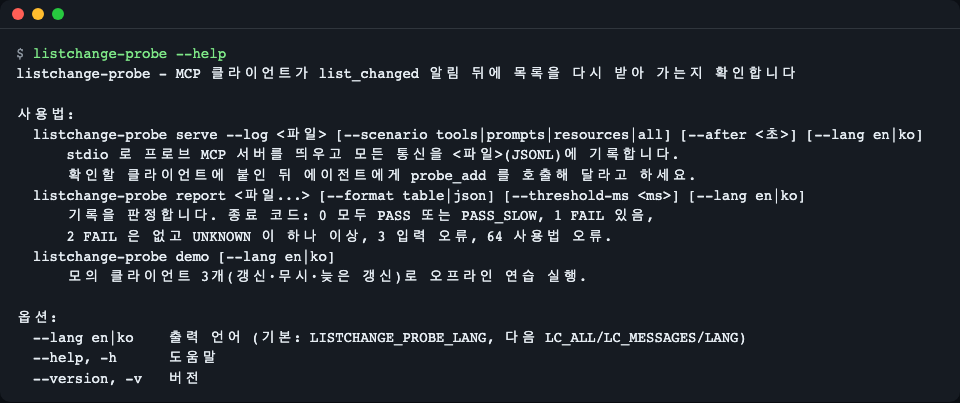
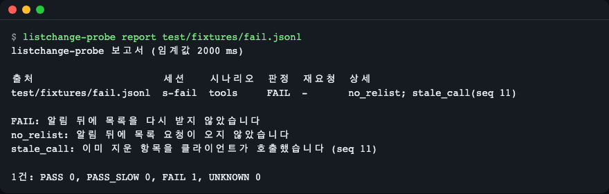
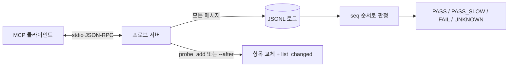

# listchange-probe

[English](README.md) | **한국어**

연결된 클라이언트를 지켜보는 MCP 서버입니다. 실행 중에 자기 도구 목록을 바꾸고 `notifications/tools/list_changed` 알림을 보낸 뒤, 클라이언트가 목록을 다시 요청했는지 기록합니다. `listchange-probe report` 가 PASS, PASS_SLOW, FAIL, UNKNOWN 으로 판정하고 근거가 되는 로그 이벤트의 `seq` 번호를 알려 줍니다.


*`listchange-probe demo`: 실제 프로브 서버에 모의(연습용 목) 클라이언트 3개를 붙여 서로 다른 판정 3가지를 보여 줍니다.*

## 이런 분께
- 실행 중에 도구를 추가·삭제하는 MCP 서버를 만드는데, 사용자가 "새 도구가 재시작해야 보인다"고 말하는 경우
- 사용자가 쓰는 클라이언트(코딩 에이전트, IDE, 채팅 앱)가 `list_changed` 를 따르는지 설계 전에 확인하고 싶은 경우
- 스크립트로 다룰 수 있는 판정(JSON 출력, 종료 코드)이 필요한 경우

## 설치
Node.js 20 이상이 필요합니다(`brew install node`, 또는 [nodejs.org](https://nodejs.org/)).

```bash
npx listchange-probe --help
```

clone 해서 쓰려면:

```bash
git clone https://github.com/LeeGyeongPil/listchange-probe
cd listchange-probe
npm install
npm run build
```

## 빠르게 시작하기
먼저 오프라인 연습용 목(mock)을 돌려 봅니다. 클라이언트도 API 키도 필요 없습니다.

```bash
npm start
```

클론 없이 하려면 `npx listchange-probe demo` 를 쓰세요.

실제 프로브 서버와 실제 판정기를 쓰지만, 클라이언트 3개는 모의 SDK 클라이언트(연습용 목)입니다. 하나는 갱신하고, 하나는 알림을 무시하고, 하나는 1.5초 늦게 갱신합니다.

```text
모의 참조 클라이언트(연습용 목) - 실제 IDE·에이전트가 아닙니다
listchange-probe 보고서 (임계값 1000 ms)

출처          세션        시나리오  판정       재요청   상세
mock:refresh  s-97791354  tools     PASS       0 ms     new_item_used=yes
mock:ignore   s-87a9d396  tools     FAIL       -        no_relist; stale_call(seq 13); new_item_used=yes
mock:delayed  s-68d8806c  tools     PASS_SLOW  1502 ms  slow_relist; new_item_used=yes
```

(세션 id 는 실행마다 다릅니다.) `mock:ignore` 를 보세요. 클라이언트가 목록을 다시 받지 않아도 새 도구 호출은 성공하므로, 새 도구가 동작하는 것은 증거가 아닙니다. 판정은 클라이언트가 목록을 다시 요청했는지로 합니다.

이제 실제 클라이언트를 확인합니다.

1. 클라이언트의 MCP 설정에 서버를 추가합니다(설정 파일 위치는 클라이언트마다 다릅니다).

   ```json
   {
     "mcpServers": {
       "listchange-probe": {
         "command": "npx",
         "args": ["-y", "listchange-probe", "serve", "--log", "/tmp/probe.jsonl"]
       }
     }
   }
   ```

2. 클라이언트를 켜고 에이전트에게 아래 문장을 그대로 붙여 넣습니다. `probe_add` 호출이 프로브 항목을 바꾸고 알림을 보내며, 이어지는 두 호출이 클라이언트가 변경을 알아챘는지 보여 줍니다.

   ```text
   Please call the probe_add tool once, then call probe_new and probe_old.
   ```

3. 로그를 판정합니다.

   ```bash
   npx listchange-probe report /tmp/probe.jsonl
   ```

에이전트가 `probe_add` 를 부르지 않으면 판정할 것이 없어 UNKNOWN 이 됩니다. `--after 10` 을 주면 클라이언트가 연결된 10초 뒤 자동으로 변경이 일어납니다.

## 사용법
| 명령·옵션 | 하는 일 | 예 |
|---|---|---|
| `serve --log <파일>` | stdio 프로브 서버를 띄우고 모든 통신을 JSONL 로 기록 | `listchange-probe serve --log probe.jsonl` |
| `serve --scenario` | `tools`(기본), `prompts`, `resources`, `all` | `serve --log p.jsonl --scenario all` |
| `serve --after <초>` | `<초>` 뒤 스스로 변경을 일으킴 | `serve --log p.jsonl --after 10` |
| `report <파일...>` | 로그 하나 이상을 판정 | `report probe.jsonl` |
| `report --format json` | 기계가 읽는 판정 | `report probe.jsonl --format json` |
| `report --threshold-ms <ms>` | 이보다 늦은 재요청은 PASS_SLOW (기본 2000, `demo` 는 1000). TypeScript SDK 클라이언트는 다시 요청하기 전에 약 300 ms(디바운스) 기다리므로 제대로 동작하는 클라이언트는 보통 300 ms 안팎에 응답합니다. 2000 ms 는 느린 컴퓨터와 다른 클라이언트를 위한 여유입니다 | `report probe.jsonl --threshold-ms 500` |
| `demo` | 모의 클라이언트 3개로 오프라인 연습 | `listchange-probe demo` |
| `--lang en\|ko` | 출력 언어 | `report probe.jsonl --lang ko` |


*`listchange-probe --help` 는 세 명령과 언어 옵션을 보여 줍니다.*

판정:

| 판정 | 뜻 |
|---|---|
| `PASS` | 임계값 안에 클라이언트가 목록을 다시 받음 |
| `PASS_SLOW` | 다시 받았지만 임계값보다 늦음 |
| `FAIL` | 알림 뒤에 목록 요청이 오지 않음 |
| `UNKNOWN` | 증거 부족(알림이 안 나갔거나 세션이 너무 일찍 끝남) |

상세 열에 붙는 사유: `stale_call`(이미 지운 항목을 호출), `refreshed_on_new_session`(재연결한 뒤에야 변경을 반영), `slow_relist`, `no_relist`.


*FAIL 판정: 알림 뒤 재요청이 없고, 로그 seq 11 에서 지워진 도구를 호출했습니다.*

### FAIL 보고서 읽기
클론한 폴더에서 실행합니다(픽스처는 npm 패키지에 들어 있지 않습니다).

```bash
npx listchange-probe report test/fixtures/fail.jsonl
```

```text
listchange-probe 보고서 (임계값 2000 ms)

출처                      세션    시나리오  판정  재요청  상세
test/fixtures/fail.jsonl  s-fail  tools     FAIL  -       no_relist; stale_call(seq 11)

FAIL: 알림 뒤에 목록을 다시 받지 않았습니다
no_relist: 알림 뒤에 목록 요청이 오지 않았습니다
stale_call: 이미 지운 항목을 클라이언트가 호출했습니다 (seq 11)

1건: PASS 0, PASS_SLOW 0, FAIL 1, UNKNOWN 0
```

괄호 안 숫자는 JSONL 로그의 `seq` 필드입니다. `seq` 는 0부터 세므로 줄 번호가 아닙니다. `"seq": 11` 은 12번째 줄에 있습니다. 로그에서 `"seq": 11` 을 검색하면 실제 요청을 볼 수 있습니다([로그 형식](#로그-형식-jsonl-v1) 참고).

### 스크립트에서 쓰기
클론한 폴더에서 실행합니다.

```bash
npx listchange-probe report test/fixtures/fail.jsonl --format json
echo $?
```

```json
[
  {
    "source": "test/fixtures/fail.jsonl",
    "session": "s-fail",
    "scenario": "tools",
    "notification_seq": 9,
    "relist_seq": null,
    "relist_delay_ms": null,
    "relist_after_last": false,
    "notification_count": 2,
    "stale_calls": [
      11
    ],
    "new_item_used": false,
    "refreshed_on_new_session": false,
    "verdict": "FAIL",
    "reasons": [
      "no_relist",
      "stale_call"
    ]
  }
]
```

`report` 종료 코드: `0` 모두 PASS 또는 PASS_SLOW, `1` FAIL 있음, `2` FAIL 은 없고 UNKNOWN 이 하나 이상, `3` 입력 오류(파일 없음, 깨진 줄. 줄 번호는 stderr), `64` 사용법 오류. JSON 출력은 언어와 무관하게 같습니다.

### 클라이언트가 알림을 무시한다면: 고정 디스패처
`examples/dispatcher-server.ts` 는 우회 예제입니다. 도구 목록은 늘 `list_capabilities` 와 `invoke` 둘로 고정하고, 새 기능은 내부 레지스트리에 추가합니다. 연결 때 목록을 캐시한 클라이언트도 새 기능에 닿을 수 있습니다.

```bash
node dist/examples/dispatcher-server.js
```

stdio 로 서버를 띄우고 시작 5초 뒤 `uptime` 기능을 추가합니다. 대가: 모델은 기능마다 타입이 있는 도구 대신 범용 `invoke` 하나를 보게 되므로 입력 검증은 핸들러 안에서 해야 합니다.

## 설정
API 키도 네트워크도 필요 없습니다.

| 설정 | 기본값 | 뜻 |
|---|---|---|
| `--lang en\|ko` | 환경에서 결정 | 출력 언어, 가장 우선 |
| `LISTCHANGE_PROBE_LANG` | 없음 | 출력 언어 `en` 또는 `ko` (`.env.example` 참고) |
| `LC_ALL`, `LC_MESSAGES`, `LANG` | 시스템 | 값이 `ko` 로 시작할 때만 한국어, 아니면 영어 |

`serve` 에는 `--log` 가 필수입니다. 같은 로그 파일로 다시 실행하면 이어 쓰므로 재연결은 두 번째 세션으로 보입니다.

## 로그 형식 (JSONL v1)
한 줄에 JSON 객체 하나입니다. 아래 줄은 `test/fixtures/fail.jsonl` 에서 가져와 줄였습니다(`ts`, `v`, `id` 생략).

```jsonl
{"seq": 0, "t_ms": 1, "session": "s-fail", "event": "start", "tool": "listchange-probe", "version": "0.1.0", "transport": "stdio", "scenarios": ["tools"]}
{"seq": 9, "t_ms": 7, "session": "s-fail", "dir": "out", "kind": "notification", "method": "notifications/tools/list_changed"}
{"seq": 4, "t_ms": 5, "session": "s-fail", "dir": "in", "kind": "request", "method": "tools/list"}
{"seq": 11, "t_ms": 3007, "session": "s-fail", "dir": "in", "kind": "request", "method": "tools/call", "name": "probe_old"}
{"seq": 12, "t_ms": 3007, "session": "s-fail", "dir": "out", "kind": "response", "error_code": -32602}
```

| 필드 | 뜻 |
|---|---|
| `seq` | 이벤트 번호. 0부터 시작하고, 같은 파일에 두 번째 실행을 이어 써도 계속 늘어납니다. 판정기는 이 순서로 판단합니다 |
| `t_ms` | 프로브 프로세스가 시작된 뒤 경과한 밀리초 |
| `session` | 세션 id. 재연결하면 새 값이 됩니다 |
| `event` | 프로브 쪽 이벤트: `start`, `mutation`(항목 교체), `close` |
| `dir` | `in` = 클라이언트에서 서버로, `out` = 서버에서 클라이언트로 |
| `kind` | `request`, `response`, `notification` |
| `method` | JSON-RPC 메서드, 예: `tools/list` |
| `name` | `tools/call` 의 항목 이름(인자는 기록하지 않습니다) |
| `error_code` | 응답의 JSON-RPC 오류 코드. 없는 도구 호출이면 `-32602` |

## 동작 원리


- 클라이언트가 연결해 프로브 항목 목록을 받습니다. 서버는 모든 메시지를 순번과 함께 기록합니다.
- `probe_add` 가 호출되거나 `--after` 시간이 되면, 서버는 옛 항목을 지우고 새 항목을 추가한 뒤 `list_changed` 를 보냅니다.
- 판정기는 시각이 아니라 순번(seq) 순서로 알림 뒤에 온 목록 요청을 찾습니다. 요청과 알림이 같은 밀리초에 찍힐 수 있기 때문입니다.
- 알림과 재요청 사이 지연이 PASS 와 PASS_SLOW 를 가릅니다. 재요청이 없으면 FAIL, 알림이 없었거나 세션이 일찍 끝났으면 UNKNOWN 입니다.
- 지워진 항목 호출은 `stale_call` 로 남고, 새 항목 호출은 기록되지만 증거로 세지 않습니다.

## 언제 쓰나
- 이럴 때: 특정 클라이언트가 `list_changed` 에 어떻게 반응하는지 지금 시점의 증거를 로그로 남기고 싶을 때, 이슈에 첨부할 로그가 필요할 때
- 이럴 때: 도구뿐 아니라 프롬프트·리소스 목록도 확인하고 싶을 때
- SDK 형태 클라이언트의 프로토콜 적합성은 [MCP conformance 프레임워크](https://github.com/modelcontextprotocol/conformance), 서버 하나를 손으로 살펴보려면 [MCP Inspector](https://github.com/modelcontextprotocol/inspector) 를 보세요.
- 한계: 지금은 stdio 만 지원합니다. 판정은 한 클라이언트의 한 번 실행 결과이지, 그 클라이언트 전반의 지원 표가 아닙니다.

## 자주 겪는 문제
| 증상 | 원인 | 해결 |
|---|---|---|
| UNKNOWN 과 `no_notification` | 에이전트가 `probe_add` 를 호출하지 않음 | `probe_add` 를 한 번 호출하라고 직접 요청하거나 `--after 10` 사용 |
| UNKNOWN 과 `session_ended_early` | 임계값이 지나기 전에 클라이언트가 연결을 끊음 | 변경 뒤 몇 초 동안 세션을 유지 |
| 종료 코드 3 | 로그가 없거나 잘렸거나 이 도구가 쓴 파일이 아님 | 경로 확인, 메시지에 문제 줄 번호가 나옴 |
| 클라이언트에 프로브 도구가 안 보임 | 설정의 명령이 시작에 실패함 | 터미널에서 `serve` 명령을 직접 실행해 stderr 확인 |
| 새 도구는 되는데 판정이 FAIL | 클라이언트가 목록을 다시 받지 않음, 이름으로 호출은 될 수 있음 | 정상입니다. `new_item_used` 참고 |

## 개발·기여
```bash
npm install
npm test
```

테스트 41개가 오프라인으로 돌아갑니다. 버그·제안은 이슈로 남겨 주세요. 변경 기록은 [CHANGELOG.md](CHANGELOG.md).

## 라이선스
MIT. [@modelcontextprotocol/sdk](https://github.com/modelcontextprotocol/typescript-sdk)(MIT)를 사용합니다.
