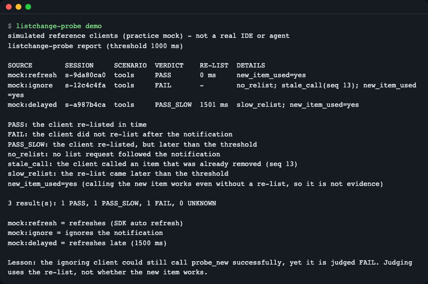
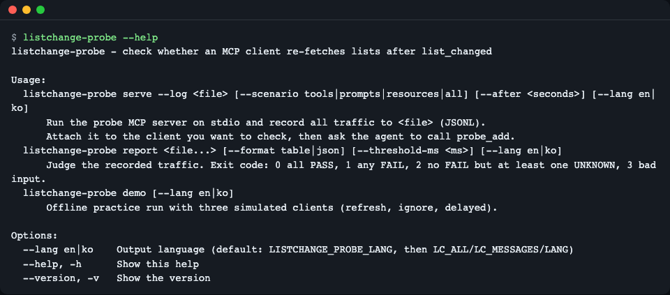
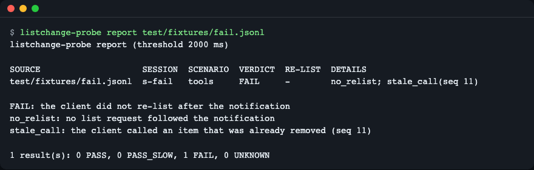
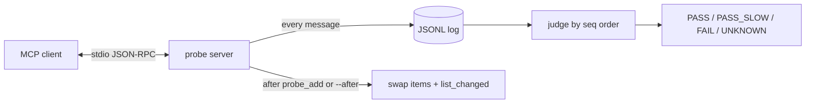

# listchange-probe

**English** | [한국어](README.ko.md)

An MCP server that watches the client connected to it. It changes its own tool list at runtime, sends `notifications/tools/list_changed`, and records whether the client asked for the list again. `listchange-probe report` then gives a verdict: PASS, PASS_SLOW, FAIL or UNKNOWN, with the `seq` numbers of the log events as evidence.


*`listchange-probe demo`: a real probe server, three simulated (practice mock) clients, three different verdicts.*

## Who it is for
- You write an MCP server that adds or removes tools while it runs, and users say "new tools only show up after a restart".
- You want to know, for the client your users run (coding agent, IDE, chat app), whether it follows `list_changed` before you design around it.
- You want a verdict you can script: JSON output and exit codes.

## Install
Requires Node.js 20 or newer (`brew install node`, or see [nodejs.org](https://nodejs.org/)).

```bash
npx listchange-probe --help
```

To work from a clone instead:

```bash
git clone https://github.com/LeeGyeongPil/listchange-probe
cd listchange-probe
npm install
npm run build
```

## Quick start
First try the offline practice mock. It needs no client and no API key:

```bash
npm start
```

Or, without cloning: `npx listchange-probe demo`.

This starts the real probe server and the real judge, but the three clients are simulated SDK clients (a practice mock): one refreshes, one ignores the notification, one refreshes 1.5 s late.

```text
simulated reference clients (practice mock) - not a real IDE or agent
listchange-probe report (threshold 1000 ms)

SOURCE        SESSION     SCENARIO  VERDICT    RE-LIST  DETAILS
mock:refresh  s-1b4ffbcc  tools     PASS       0 ms     new_item_used=yes
mock:ignore   s-5bec6065  tools     FAIL       -        no_relist; stale_call(seq 13); new_item_used=yes
mock:delayed  s-4e6e020a  tools     PASS_SLOW  1501 ms  slow_relist; new_item_used=yes
```

(Session ids differ on every run.) Note `mock:ignore`: calling the new tool works even when the client never re-listed, so a working new tool is not proof. The verdict is based on whether the client asked for the list again.

Now probe a real client:

1. Add the server to the client's MCP config (the exact file depends on the client):

   ```json
   {
     "mcpServers": {
       "listchange-probe": {
         "command": "npx",
         "args": ["-y", "listchange-probe", "serve", "--log", "/tmp/probe.jsonl"]
       }
     }
   }
   ```

2. Start the client and paste this sentence to its agent. Calling `probe_add` swaps the probe items and sends the notification; the next two calls show whether the client noticed:

   ```text
   Please call the probe_add tool once, then call probe_new and probe_old.
   ```

3. Judge the log:

   ```bash
   npx listchange-probe report /tmp/probe.jsonl
   ```

If the agent never calls `probe_add`, there is nothing to judge and the verdict is UNKNOWN. Use `--after 10` to trigger the change automatically 10 seconds after the client connects.

## Usage
| Command | What it does | Example |
|---|---|---|
| `serve --log <file>` | Runs the probe server on stdio and records all traffic as JSONL | `listchange-probe serve --log probe.jsonl` |
| `serve --scenario` | `tools` (default), `prompts`, `resources` or `all` | `serve --log p.jsonl --scenario all` |
| `serve --after <s>` | Triggers the change by itself after `<s>` seconds | `serve --log p.jsonl --after 10` |
| `report <file...>` | Judges one or more logs | `report probe.jsonl` |
| `report --format json` | Machine-readable verdicts | `report probe.jsonl --format json` |
| `report --threshold-ms <ms>` | Re-list slower than this is PASS_SLOW (default 2000; `demo` uses 1000). The TypeScript SDK client waits about 300 ms (debounce) before re-listing, so a well-behaved client usually answers in roughly 300 ms; 2000 ms leaves room for slow machines and other clients | `report probe.jsonl --threshold-ms 500` |
| `demo` | Offline practice run with three simulated clients | `listchange-probe demo` |
| `--lang en\|ko` | Output language | `report probe.jsonl --lang ko` |


*`listchange-probe --help` lists the three commands and the language option.*

Verdicts:

| Verdict | Meaning |
|---|---|
| `PASS` | The client re-listed within the threshold |
| `PASS_SLOW` | It re-listed, but later than the threshold |
| `FAIL` | No list request followed the notification |
| `UNKNOWN` | Not enough evidence (no notification was sent, or the session ended too early) |

Extra reasons shown in DETAILS: `stale_call` (the client called an item that was already removed), `refreshed_on_new_session` (the client only picked up the change after reconnecting), `slow_relist`, `no_relist`.


*A FAIL verdict: no re-list after the notification, and a stale call to the removed tool at log seq 11.*

### Read a FAIL report
From a clone (the fixtures are not in the npm package):

```bash
npx listchange-probe report test/fixtures/fail.jsonl
```

```text
listchange-probe report (threshold 2000 ms)

SOURCE                    SESSION  SCENARIO  VERDICT  RE-LIST  DETAILS
test/fixtures/fail.jsonl  s-fail   tools     FAIL     -        no_relist; stale_call(seq 11)

FAIL: the client did not re-list after the notification
no_relist: no list request followed the notification
stale_call: the client called an item that was already removed (seq 11)

1 result(s): 0 PASS, 0 PASS_SLOW, 1 FAIL, 0 UNKNOWN
```

The numbers in parentheses are the `seq` field of the JSONL log. `seq` counts from 0, so it is not the line number: `"seq": 11` is on line 12. Search the log for `"seq": 11` to see the exact request (see [Log format](#log-format-jsonl-v1)).

### Use it in scripts
From a clone:

```bash
npx listchange-probe report test/fixtures/fail.jsonl --format json
echo $?
```

```json
[
  {
    "source": "test/fixtures/fail.jsonl",
    "session": "s-fail",
    "scenario": "tools",
    "notification_seq": 9,
    "relist_seq": null,
    "relist_delay_ms": null,
    "relist_after_last": false,
    "notification_count": 2,
    "stale_calls": [
      11
    ],
    "new_item_used": false,
    "refreshed_on_new_session": false,
    "verdict": "FAIL",
    "reasons": [
      "no_relist",
      "stale_call"
    ]
  }
]
```

Exit codes of `report`: `0` all PASS or PASS_SLOW, `1` any FAIL, `2` no FAIL but at least one UNKNOWN, `3` bad input (missing file, malformed line; the line number goes to stderr), `64` usage error. JSON output does not change with the language.

### If a client ignores the notification: a fixed dispatcher
`examples/dispatcher-server.ts` shows a workaround. The tool list never changes (always `list_capabilities` and `invoke`), and new abilities are added to an internal registry, so even a client that cached the list at connect time can reach them.

```bash
node dist/examples/dispatcher-server.js
```

It serves on stdio and adds an `uptime` ability 5 seconds after start. Trade-off: the model sees one generic `invoke` tool instead of one typed tool per ability, so validate inputs inside the handler.

## Configuration
No API key and no network are needed.

| Setting | Default | Meaning |
|---|---|---|
| `--lang en\|ko` | from environment | Output language, highest priority |
| `LISTCHANGE_PROBE_LANG` | unset | Output language `en` or `ko` (see `.env.example`) |
| `LC_ALL`, `LC_MESSAGES`, `LANG` | system | Korean only if the value starts with `ko`, otherwise English |

Server-side `--log` is required for `serve`. A second run with the same log file appends to it, so a reconnect shows up as a second session.

## Log format (JSONL v1)
One JSON object per line. These lines come from `test/fixtures/fail.jsonl` (shortened: `ts`, `v` and `id` left out):

```jsonl
{"seq": 0, "t_ms": 1, "session": "s-fail", "event": "start", "tool": "listchange-probe", "version": "0.1.0", "transport": "stdio", "scenarios": ["tools"]}
{"seq": 9, "t_ms": 7, "session": "s-fail", "dir": "out", "kind": "notification", "method": "notifications/tools/list_changed"}
{"seq": 4, "t_ms": 5, "session": "s-fail", "dir": "in", "kind": "request", "method": "tools/list"}
{"seq": 11, "t_ms": 3007, "session": "s-fail", "dir": "in", "kind": "request", "method": "tools/call", "name": "probe_old"}
{"seq": 12, "t_ms": 3007, "session": "s-fail", "dir": "out", "kind": "response", "error_code": -32602}
```

| Field | Meaning |
|---|---|
| `seq` | Event counter, starts at 0 and keeps counting when a second run is appended to the same file. The judge orders events by it |
| `t_ms` | Milliseconds since the probe process started |
| `session` | Session id; a reconnect gets a new one |
| `event` | Probe-side events: `start`, `mutation` (items swapped), `close` |
| `dir` | `in` = client to server, `out` = server to client |
| `kind` | `request`, `response` or `notification` |
| `method` | JSON-RPC method, e.g. `tools/list` |
| `name` | Item name for `tools/call` (arguments are never logged) |
| `error_code` | JSON-RPC error code of a response, e.g. `-32602` for a call to an unknown tool |

## How it works


- The client connects and lists the probe items. The server records every message with a sequence number.
- When `probe_add` is called (or `--after` fires), the server removes the old item, adds the new one and sends `list_changed`.
- The judge looks for a list request that comes after the notification in sequence order, not by timestamp, because a request and a notification can share the same millisecond.
- Delay between notification and re-list decides PASS or PASS_SLOW. No re-list decides FAIL. No notification, or a session that ended early, is UNKNOWN.
- Calling the removed item adds `stale_call`; calling the new item is recorded but never counts as proof.

## When to use it
- Good fit: you need evidence of how one specific client reacts to `list_changed`, today, with a log you can keep or attach to an issue.
- Good fit: you want to check prompts and resources lists as well as tools.
- For protocol conformance of SDK-style clients, see the [MCP conformance framework](https://github.com/modelcontextprotocol/conformance). For inspecting a single server by hand, see [MCP Inspector](https://github.com/modelcontextprotocol/inspector).
- Limits: stdio only for now. Verdicts describe what one client did in one run; they are not a support table for the client in general.

## Troubleshooting
| Symptom | Cause | Fix |
|---|---|---|
| Verdict is UNKNOWN with `no_notification` | The agent never called `probe_add` | Ask it explicitly to call `probe_add` once, or use `--after 10` |
| UNKNOWN with `session_ended_early` | The client disconnected before the threshold passed | Keep the session open a few seconds after the change |
| Exit code 3 | Log missing, cut off, or not written by this tool | Check the path; the message names the bad line |
| The client shows no tools from the probe | The command in its config failed to start | Run the `serve` command in a terminal and read stderr |
| New tool works but verdict is FAIL | The client did not re-list; calling a tool by name can still work | This is expected, see `new_item_used` |

## Development
```bash
npm install
npm test
```

40 tests run offline. Bugs and suggestions are welcome as issues. Changes are recorded in [CHANGELOG.md](CHANGELOG.md).

## License
MIT. Built on [@modelcontextprotocol/sdk](https://github.com/modelcontextprotocol/typescript-sdk) (MIT).
